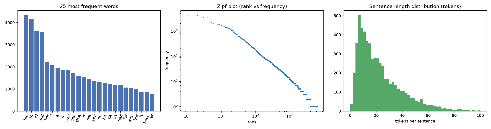
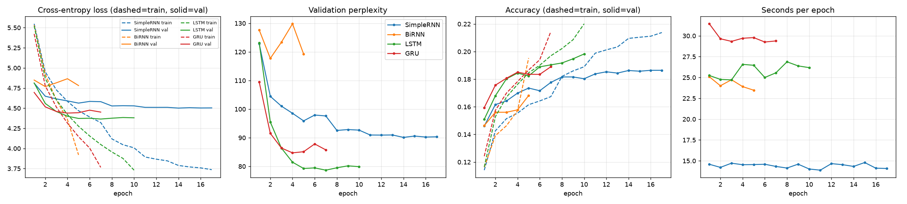
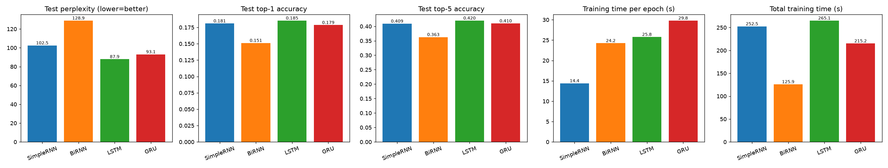
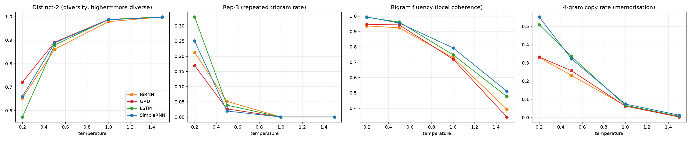

# Austen-RNN: Autoregressive Text Generation with Simple RNN, Bidirectional RNN, LSTM and GRU

**Foundations of Generative AI (ICT4403), Assignment 2**

This is a word-level autoregressive text-generation system trained on Jane Austen's *Pride and Prejudice*.
Four recurrent architectures were trained under the same experimental conditions. Each one predicts the next
word and generates text one word at a time, and they are compared both quantitatively and qualitatively at
four sampling temperatures.

---

## 1. Problem statement and objective

Given the previous $n$ words of a text, a language model estimates the probability of the next word,
$p(w_t \mid w_{t-n}, \dots, w_{t-1})$. Generation is **autoregressive**: a word is sampled from that
distribution, appended to the context, and the process repeats.

**Objectives**

1. Describe and pre-process a textual dataset, then build the input → next-word target sequences.
2. Implement and train **Simple RNN, Bidirectional RNN, LSTM and GRU** next-word models under the same conditions.
3. Compare them on **loss, perplexity, top-1/top-5 accuracy and training time**, and on generated-text
   **coherence, diversity, contextual consistency and repetition**.
4. Generate from the **same seed sequences at several temperatures** (0.2, 0.5, 1.0, 1.5), analyse how temperature
   affects the output, and identify the most effective model.

## 2. Dataset

| | |
|---|---|
| **Name** | *Pride and Prejudice*, Jane Austen (1813), Project Gutenberg eBook **#1342** |
| **Source link** | <https://www.gutenberg.org/ebooks/1342> |
| **Plain-text file used** | <https://www.gutenberg.org/cache/epub/1342/pg1342.txt> (copy in [`data/pride_and_prejudice.txt`](data/pride_and_prejudice.txt)) |
| **Licence** | Public domain in the USA (Project Gutenberg licence) |

**Characteristics** (from [`results/dataset_stats.json`](results/dataset_stats.json)):

| Property | Value |
|---|---|
| Raw file size | 748,167 characters |
| Novel text (licence/front matter removed) | 694,354 characters, 61 chapters, ~2,370 paragraphs |
| Sentences / mean sentence length | 5,912 / 22.6 tokens |
| Tokens (words + punctuation) | 139,440 |
| Word tokens / unique words | 122,176 / 6,316 |
| Hapax legomena (words seen once) | 2,362 (37 % of the vocabulary) |
| Vocabulary used (train words with freq ≥ 2, + `<pad>`, `<unk>`) | **3,606** |
| `<unk>` rate train / val / test | 2.1 % / 3.1 % / 3.3 % |
| Sequences train / val / test | 111,532 / 13,924 / 13,924 |

The novel is formal early-19th-century English prose with a lot of dialogue (`said elizabeth`, `I am sure`),
a small recurring cast, and a Zipfian word distribution. That makes it a compact, self-contained corpus for a
next-word model trained on a CPU.



### Pre-processing ([`textgen/data.py`](textgen/data.py))
1. Keep only the novel, from *"It is a truth universally acknowledged…"* to its last sentence. The Gutenberg header and
   licence, the list of illustrations, the multi-line `[Illustration: …]` captions (nested brackets are handled) and
   the printer's colophon are removed.
2. Remove `CHAPTER …` headings and `_italic_` markers, normalise curly quotes, split hyphens and dashes, lower-case the
   text, and turn `mr.`/`mrs.`/`dr.` into `mr`/`mrs`/`dr` so that `.` always marks the end of a sentence.
3. Tokenise at the word level. Words keep internal apostrophes (`don't`, `elizabeth's`), and the punctuation marks
   `. , ; : ! ?` become separate tokens so the model also learns sentence structure.
4. Split the token stream **contiguously** into 80 / 10 / 10 % train/val/test, so that overlapping windows cannot leak
   between splits. The vocabulary is built from the **training split only** (min frequency 2; rarer words become `<unk>`).

### Input–target sequences
A stride-1 sliding window over the token ids builds the pairs
$X_i = (w_i,\dots,w_{i+19}) \rightarrow y_i = w_{i+20}$ (context length **n = 20**). For example:

| input (20 tokens) | target |
|---|---|
| `it is a truth universally acknowledged , that a single man in possession of a good fortune must be in` | `want` |

## 3. Models ([`textgen/models.py`](textgen/models.py))

All models share `Embedding(3606, 128) → recurrent layer (hidden 256, 1 layer) → Dropout(0.3) → Linear(→3606)`.
They read the 20-token context and predict the next token (many-to-one).

| Model | Recurrent layer | Parameters | Description |
|---|---|---|---|
| **SimpleRNN** | `nn.RNN` (tanh) | 1.49 M | $h_t=\tanh(W_x x_t+W_h h_{t-1}+b)$. Simplest recurrence; suffers from vanishing gradients |
| **BiRNN** | `nn.RNN`, bidirectional | 2.51 M | Reads the context window forwards and backwards; the two final states are concatenated (512-d). The target lies **outside** the window, so the model is still autoregressive |
| **LSTM** | `nn.LSTM` | 1.78 M | Input/forget/output gates plus a cell state that stores long-range information |
| **GRU** | `nn.GRU` | 1.68 M | Update/reset gates. Lighter than an LSTM, with similar gating benefits |

**Same conditions for all models:** same data, splits and vocabulary; embedding 128, hidden 256, dropout 0.3;
Adam (lr 2e-3) with ReduceLROnPlateau (×0.5, patience 1); batch size 256; gradient-norm clipping 5.0; at most 20 epochs
with **early stopping** (patience 3) on validation loss, after which the best checkpoint is restored; and the same random
seed (42), so every model starts from the same RNG state and sees the same batch order. All training ran on a CPU (8 threads).

## 4. How to run

```bash
git clone https://github.com/<your-username>/fgai-autoregressive-text-generation.git
cd fgai-autoregressive-text-generation
pip install -r requirements.txt          # torch, numpy, pandas, matplotlib, jupyter

# Option A: notebook (main deliverable, already executed with all outputs)
jupyter notebook FGAI_Assignment2_TextGeneration.ipynb      # Run All, about 15 min on CPU

# Option B: script
python run_experiments.py               # full run -> results/ and models/
python run_experiments.py --quick       # 2-epoch smoke test -> results_quick/
```

Tested with Python 3.14, PyTorch 2.13 (CPU), NumPy 2.5, pandas 3.0 and matplotlib on Windows. If the dataset file is
missing, it is downloaded automatically.

### Repository structure
```
├── FGAI_Assignment2_TextGeneration.ipynb   # end-to-end notebook (executed, with outputs)
├── run_experiments.py                      # same pipeline as a script
├── textgen/
│   ├── data.py         # download, cleaning, tokenisation, vocabulary, sliding-window sequences
│   ├── models.py       # SimpleRNN / BiRNN / LSTM / GRU language models
│   ├── train.py        # training loop, early stopping, loss/perplexity/accuracy evaluation
│   ├── generate.py     # temperature sampling + diversity/repetition/coherence metrics
│   └── experiment.py   # config, train-all, generate-all, plots
├── data/pride_and_prejudice.txt
├── models/             # trained checkpoints (*.pt, best validation epoch)
├── results/
│   ├── metrics.csv               # quantitative comparison
│   ├── training_history.json     # per-epoch curves
│   ├── generation_metrics.csv    # text metrics per model × temperature
│   ├── generated_samples.md      # readable samples (same seeds, all models/temperatures)
│   ├── generated_samples.csv     # all 240 generations with metrics
│   ├── dataset_stats.json, config.json
│   └── plots/                    # dataset, training curves, comparison, temperature plots
└── requirements.txt
```

## 5. Results

### 5.1 Quantitative comparison (test set, best-validation checkpoint)

| Model | Params | Best / run epochs | Train loss | Val loss | **Test loss** | **Test PPL ↓** | **Top-1 acc ↑** | **Top-5 acc ↑** | s / epoch | Total train time |
|---|---|---|---|---|---|---|---|---|---|---|
| SimpleRNN | 1.49 M | 14 / 17 | 3.256 | 4.501 | 4.630 | 102.5 | 18.10 % | 40.93 % | **14.4 s** | 253 s |
| BiRNN | 2.51 M | 2 / 5 | 4.058 | 4.768 | 4.859 | 128.9 | 15.12 % | 36.28 % | 24.2 s | **126 s** |
| **LSTM** | 1.78 M | 7 / 10 | 3.532 | **4.365** | **4.476** | **87.9** | **18.54 %** | **41.99 %** | 25.8 s | 265 s |
| GRU | 1.68 M | 4 / 7 | 3.673 | 4.439 | 4.533 | 93.1 | 17.85 % | 41.01 % | 29.8 s | 215 s |

(Loss is cross-entropy in nats; perplexity is $e^{\text{loss}}$. Accuracy is the proportion of exactly-predicted next words.
For reference, always predicting the most frequent token `,` gives about 7 % accuracy and a uniform guess gives a perplexity of 3,606.)




**Observations**
* **LSTM is best on every predictive metric**: lowest test perplexity (87.9, 14 % lower than the Simple RNN),
  highest top-1 (18.5 %) and top-5 (42.0 %) accuracy. Its gates let it make good use of the whole 20-word context.
* **GRU** is a close second (PPL 93.1). It learns fastest, reaching the best validation loss of any model at epoch 4,
  but starts to overfit earlier.
* **SimpleRNN** learns slowly but steadily (best epoch 14). It is the cheapest per epoch (14 s, about 1.8× faster than
  LSTM/GRU), but its validation loss levels off around 4.50 because vanishing gradients limit how much of the context it can use.
* **BiRNN** is worst (PPL 128.9) and **overfits after 2 epochs**: train loss falls sharply while validation loss rises.
  For next-word prediction the backward pass adds no information that the forward pass lacks (it re-reads the same past
  words in reverse). It does double the size of the output layer's input, giving 2.5 M parameters, so it memorises the
  training data quickly. Bidirectionality helps when the *whole* input is known in advance (tagging, classification),
  not for causal generation.
* **Training time:** SimpleRNN < BiRNN ≈ LSTM < GRU per epoch on CPU. The GRU's extra time comes from PyTorch's CPU
  kernel rather than from its FLOP count (a GRU has fewer gates than an LSTM). Total time also depends on when early
  stopping triggered.

### 5.2 Generated-text evaluation

Each model generated text from 5 seed sequences × 4 temperatures × 3 samples × 50 tokens (240 generations in total).
The same sampling RNG stream was used for every model, so differences in output come from the models themselves.
Automatic measures, averaged per model and temperature ([`results/generation_metrics.csv`](results/generation_metrics.csv)):

* **Distinct-1/2** (diversity): unique uni/bi-grams ÷ total.
* **Rep-3** (repetition): share of trigrams that already appeared earlier in the same continuation.
* **Bigram fluency** (local coherence): share of generated bigrams that also occur in the training text.
* **4-gram copy rate** (memorisation): share of generated 4-grams copied verbatim from the training text.

| Model | T | Distinct-1 | Distinct-2 | Rep-3 ↓ | Bigram fluency | 4-gram copy |
|---|---|---|---|---|---|---|
| SimpleRNN | 0.2 | 0.477 | 0.660 | 0.250 | 0.995 | 0.552 |
| | 0.5 | 0.629 | 0.888 | 0.019 | 0.955 | 0.322 |
| | 1.0 | 0.793 | 0.986 | 0.000 | 0.793 | 0.074 |
| | 1.5 | 0.873 | 0.997 | 0.000 | 0.511 | 0.013 |
| BiRNN | 0.2 | 0.459 | 0.653 | 0.213 | 0.936 | 0.329 |
| | 0.5 | 0.609 | 0.861 | 0.051 | 0.924 | 0.231 |
| | 1.0 | 0.780 | 0.978 | 0.000 | 0.729 | 0.065 |
| | 1.5 | 0.899 | 0.999 | 0.000 | 0.393 | 0.004 |
| **LSTM** | 0.2 | 0.423 | 0.573 | 0.329 | 0.992 | 0.509 |
| | **0.5** | 0.648 | 0.879 | 0.039 | **0.961** | 0.335 |
| | 1.0 | 0.821 | 0.988 | 0.000 | 0.748 | 0.067 |
| | 1.5 | 0.897 | 0.999 | 0.000 | 0.476 | 0.007 |
| GRU | 0.2 | 0.524 | 0.721 | 0.169 | 0.947 | 0.332 |
| | 0.5 | 0.659 | 0.891 | 0.026 | 0.943 | 0.257 |
| | 1.0 | 0.811 | 0.988 | 0.000 | 0.720 | 0.062 |
| | 1.5 | 0.920 | 0.999 | 0.000 | 0.343 | 0.003 |

**Qualitative comparison** (full side-by-side samples: [`results/generated_samples.md`](results/generated_samples.md)).
Here are some examples at **T = 0.5**:

> **Seed:** *"My dear Mr. Bennet, said his lady to him one day,"*
> **LSTM:** *and Mr. darcy is a very agreeable man, and I am afraid of you will not be able to keep the country. I am not afraid of the room, I am sure, replied elizabeth.*
> **GRU:** *and Mr. darcy has been to make him, he continued, and his attentions of his being now and his friend, and he was at leisure by the entrance of the scene…*
> **BiRNN:** *and Mr. wickham, you know a great deal, he will not be too much. But I am sure, I am sure to be married, but I am sure, and I shall be married…*
> **SimpleRNN:** *I have not seen to know a good deal of my own. I am not afraid of my situation, said elizabeth, with her civility…*

> **Seed:** *"The ball at Netherfield was"*
> **GRU:** *a mixture of his friend; and she had no more to say for the best of the following hour. But when he had been in the drawing room, and the evening was spent in the country, they parted…*
> **LSTM:** *a very welcome distance; but he was a most disagreeable to see the matter, and elizabeth began to engage her, and the first opportunity of the shire, and the evening was soon found to be mistaken…*

| Criterion | SimpleRNN | BiRNN | LSTM | GRU |
|---|---|---|---|---|
| **Coherence** (grammar within a clause) | Good locally, but sentences drift and phrase fragments get stitched together | Weakest: broken constructions (*"I shall not be to be the frequent of her own"*) | **Best**: most well-formed clauses and dialogue tags (*"replied elizabeth."*) | Very good, long fluent clauses |
| **Contextual consistency** (stays on topic) | Often ignores the seed and falls back to `I am sure, said elizabeth` | Generic *"the gentlemen of … the ladies of …"* chains | Keeps the seed's theme (Mr. Bennet → Mr. Darcy, *"agreeable man"*; ball → evening, *engage her*) | Strong scene continuity (ball → drawing room, evening, parted) |
| **Diversity** | Medium | Lowest Distinct-2 at T ≤ 1 | Medium; lowest at T = 0.2 | **Highest** at every temperature |
| **Repetition** | Loops at low T (*"I am sure, I am sure…"*) | Loops (*"to be married"*) | Most looping at T = 0.2 (Rep-3 0.33), little at T = 0.5 | **Least** looping at low T (Rep-3 0.17) |
| **Memorisation** | Highest 4-gram copy rate (0.55 at T = 0.2), so it reuses stock phrases | Low | High at T = 0.2 | Low |

The SimpleRNN has the highest *bigram fluency* at high temperature, but this does not mean its text is more coherent. It
overfits the training set the most (train loss 3.26 against test 4.63), so its output distributions are sharper, and it
copies more training phrases verbatim (highest copy rate). Its continuations still lose track of the seed.

## 6. Sampling-temperature analysis

$p_i \propto \exp(z_i / T)$: a low **T** sharpens the distribution towards the arg-max, and a high **T** flattens it towards uniform.



Mean over the four models:

| T | Distinct-1 | Distinct-2 | Rep-3 | Bigram fluency | 4-gram copy | Behaviour |
|---|---|---|---|---|---|---|
| **0.2** | 0.47 | 0.65 | **0.24** | **0.97** | 0.43 | Nearly greedy. Grammatical but degenerate: loops on high-frequency phrases (*"I am sure, said elizabeth, I am sure…"*, *"the carriage drove, and the carriage drove"*) and copies training text |
| **0.5** | 0.64 | 0.88 | 0.03 | 0.95 | 0.29 | **Best trade-off.** Still fluent, repetition almost gone, varied and Austen-like sentences |
| **1.0** | 0.80 | 0.99 | 0.00 | 0.75 | 0.07 | Samples the learned distribution as-is. Very diverse, vocabulary is plausible, but grammar breaks every few words (*"The town seemed to flatter it, and, we must be very welcome"*) |
| **1.5** | 0.90 | 1.00 | 0.00 | 0.43 | 0.01 | Mostly word salad (*"Third aspect time as we that he began Mr. consequence evident miss bingley…"*). Over half of the bigrams never occur in the novel |

* **Coherence** falls steadily as T rises (bigram fluency 0.97 → 0.43).
* **Diversity** rises steadily (Distinct-2 0.65 → 1.00).
* **Repetition** is a low-temperature problem only: Rep-3 is 0.24 at T = 0.2, about 0.03 at T = 0.5 and 0 for T ≥ 1.
* Temperature affects the output more than the choice of architecture does. At each T all four models fall in a narrow
  band, but the ranking within the band is consistent. LSTM has the highest fluency of the gated models; GRU has the
  highest diversity and the least repetition. **T ≈ 0.5** works best for every model on this dataset.

## 7. Conclusion: best-performing model

**The LSTM is the most effective autoregressive generator for *Pride and Prejudice*.**

* It has the **lowest test loss and perplexity** (4.476 / 87.9) and the **highest top-1 and top-5 accuracy**
  (18.5 % / 42.0 %), so it models the next-word distribution best.
* At the recommended temperature **T = 0.5** it gives the most coherent text of all models (bigram fluency 0.961,
  Rep-3 only 0.039). Its continuations are grammatical, stay consistent with the seed, and keep Austen's dialogue style.
* Its forget gate and cell state carry information across the 20-token window, which the Simple RNN cannot do because
  of vanishing gradients.

**GRU** is a close runner-up (PPL 93.1). It converges fastest and produces the most diverse, least repetitive text, so
it is a good choice when diversity matters more. **SimpleRNN** is the cheapest per epoch but has the weakest context
handling. **BiRNN** is the least suitable: in causal next-word generation the backward pass adds parameters but no
information, which led to fast overfitting and the worst perplexity.

**Limitations and possible extensions:** the corpus is small (about 140 k tokens) and the models are single-layer. A
larger corpus, stacked layers, longer contexts, weight tying, top-k/nucleus sampling, or a Transformer decoder would
improve coherence further.
